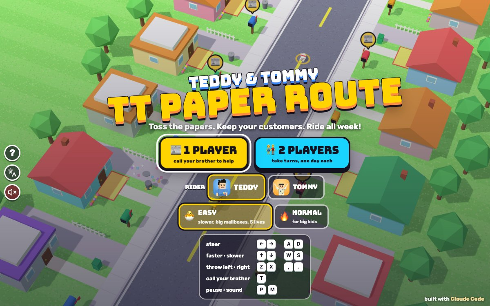

# TT Paper Route

[](https://adong.github.io/paper-route-tt/)

Press **?** any time (or tap the round **?** button on the left edge) to see the keys. The game waits while you look.
Tap the language button under it (the A文 icon) to switch between English and 中文; the dashboard and every game remember the choice.

**中文：** 送报小骑手：骑着自行车沿着阳光大街送报纸，把报纸扔进客户的信箱或者门垫上，躲开洒水器、滑板、机器人割草机、想玩的小狗和倒车的汽车。从星期一送到星期天：送到的客户继续订，错过的就不订了。单人（随时叫兄弟来帮忙）或 Teddy 和 Tommy 轮流骑。

An arcade paper-route game starring Teddy and Tommy, built with Claude Code from plain JavaScript and Three.js on the shared Claude Games kit.
You ride a bike up a sunny street, seen at a slant from a fixed arcade camera, and toss rolled-up newspapers into the mailboxes and onto the doormats of the houses that ordered one. Dodge the sprinklers, rolling skateboards, robot lawnmowers, a puppy that wants to play and cars backing out of their driveways. Ride over paper bundles to fill your bag. Each day ends in a bonus park with ramps to jump and targets to hit, and a week runs from Monday to Sunday.
Nobody gets hurt and nothing breaks: a tumble is a silly heap with stars ("SPLASH!", "LICK LICK!"), a paper bonks off a house wall and drops, a puppy that catches a paper trots home happy with it, a mower hit by a paper sneezes and floats away, and a skateboard goes WHOOSH.
There are no image, model or audio files: the boys are the kit's blocky characters on cruiser bikes, the street is built from boxes and wedges, every texture is painted on a canvas, and every sound is synthesised.
It's our own game: our own name, characters, art and sounds.

The name lives in one place, `PR.TITLE` in `js/title.js` (and `PR.ZH`, 送报小骑手, for the 中文 logo and the ? panel). Change it there (and in the `<title>` of `index.html`) and the logo, menus and the ? panel follow.

## Play

- **Double-click `index.html`.** It works offline because Three.js and the kit are copied into `kit/`. Without internet the title font falls back to Arial Black.
- **Send one file:** `dist/paper-route-tt.html` is the whole game in one file, about 860 KB. AirDrop or email it, then open it in a browser.
- Rebuild that file after any edit: `python3 kit/tools/bundle.py . --name paper-route-tt`

Pick **📰 1 PLAYER** or **👫 2 PLAYERS** on the title screen. For 1 player pick the rider (Teddy or Tommy) and a difficulty; for 2 players each brother picks his own difficulty.

| Difficulty | |
|---|---|
| 🐣 **EASY** (the default), for Tommy (5) | 5 lives. Slower riding (2.5 to 6 m/s, cruising at 4) and slower obstacles, 2 to 6 of them a day. Mailboxes are drawn bigger and catch a paper from 1.5 m away; doormats are bigger too. Papers keep less of the bike's speed, so they land closer to where you aim. 15 papers to start, bundles of 8. You always keep at least 4 customers. |
| 🔥 **NORMAL**, for Teddy (8) | 3 lives. Faster (3.5 to 8.5 m/s), 4 to 10 obstacles a day and a bit quicker each day. Mailboxes catch within 0.85 m. 10 papers, bundles of 5. Lose every customer and the week is over. |

## Rules

- **Riding:** you always roll up the street. ← → steer across the road and sidewalks, ↑ pedals faster and ↓ slows down.
- **Throwing:** Z throws a paper to the left, X to the right. It flies sideways, keeps some of the bike's speed and falls; where it goes decides what it does:
  - through a **mailbox** slot (the yellow 📰 badge floats over the ones that want a paper today): **250**, "IN THE MAILBOX!";
  - onto the **doormat** in front of the door: **100**, "ON THE MAT!" A paper that bonks off the house wall drops, and can still land on the mat;
  - a **can or bin** on the lawn: **100** bonus;
  - a house that didn't order: "NO PAPER HERE!" (nothing lost), and nothing ever breaks.
  - A mailbox counts only once a day; the badge turns into a ✅.
- **Customers:** bright houses with a raised red mailbox flag ordered a paper. Faded houses with the flag down didn't.
- **Obstacles** (a bump is a tumble and one life; you get back up blinking and safe for 2 s):
  - 💦 **sprinklers** spray across the sidewalk on and off: ride in the street while they're on;
  - 🛹 **skateboards** roll across the street; a paper sends one WHOOSHing off (+50);
  - 🤖 **robot mowers** buzz up and down the sidewalk; a paper makes one sneeze and float away (+100);
  - 🐶 **a puppy** runs out to play when you come by; give it a paper and it trots home happy (+100);
  - 🚗 **cars** back out of their driveways into the street, BEEP BEEP, wait, and pull back in.
- **Paper bundles** 📰 lie in the street: ride over one to fill your bag. With no papers left, "NO PAPERS LEFT!".
- **The bonus park** at the end of every street: your bag is topped up to 10, ramps launch you into the air (WHEEE! +100 each), hay bales go BOING (no life lost) and targets on both sides are worth +200. Reaching the finish line is +300, and your rider hops off and does his signature move.
- **The week:** each day you ride the same street.
  - Houses you delivered to **stay customers**; customers you **missed stop ordering**.
  - A **perfect day** (every customer got a paper) is +500 and **one more house orders** again.
  - On EASY, if you would drop under 4 customers, **new neighbours** order a paper (never the ones who just stopped).
  - On NORMAL, no customers left means **NO MORE CUSTOMERS!**
  - After each day "THE DAILY TT" shows how it went: a headline, who kept ordering (✓), who stopped (✗), who came back (★), and your score.
- **Win:** ride all seven days. "WEEK DONE!": the rider does his signature move at the finish line (Teddy shadow-boxes and sinks a 🏀 jump shot, Tommy does his Y pose ✌️), confetti, your score and HI-SCORE (kept for each difficulty), and **PLAY AGAIN**.
- **Out of lives:** "OOPS!" **KEEP GOING** rides the same day again with full lives (and the score you had that morning); **PLAY AGAIN** starts a new week.
- **2 players take turns**, one day each: Teddy's Monday, Tommy's Monday, Teddy's Tuesday... Each brother has his own customers, lives, score and difficulty on the same street. A brother out of lives (or customers) sits out while the other finishes his week. At the end the higher score wins and does his signature move.

The street and each day's obstacles are made from a seed (`js/street.js`), spaced so there is always a way past. Every day of every difficulty is checked to be rideable (below).

## Controls

| | Keys | Or | Touch |
|---|---|---|---|
| steer | ← → | A D | the round pad, left and right |
| faster · slower | ↑ ↓ | W S | the pad, up and down |
| throw a paper left · right | Z X | , . | the ⬅ and ➡ paper buttons |
| call your brother | T | | the big button with his face |

- The arrow you pressed last wins while you hold two, and a tap shorter than a frame still steers for a moment.
- With two players the brothers take turns, so both sets of keys work for whoever is riding.
- **P** or Esc pauses and **M** turns the sound on or off. The ❚❚ and 🔊 buttons at the top do the same. On the menus, the round speaker button under the A文 button (and the speaker in the ? panel) mutes too, and they all stay in step.
- **Menus:** ← → pick 1 or 2 players, ↑ ↓ (or W S) switch Easy / Normal, A D switch the rider, Enter or Space goes, 1 and 2 jump straight in. On the newspaper and the results, Enter goes on and Esc goes to the menu.
- **Touch:** the pad sits bottom left (just right of the ? and A文 buttons on a sideways screen), the two paper buttons bottom right, and your brother's button above them. The camera fits the street into the space they leave.

## Companion

Your companion is the other brother: **Tommy** comes for Teddy, and **Teddy** comes when Tommy is riding (`Kit.roster.buddyFor`).

- **Calling him:** press **T** or tap the big button with his face, any time and as often as you like. He pops in on his own bike right beside you, at his smaller buddy size, in a puff of confetti ("TOMMY IS HERE!").
- **His signature move**, while riding: Tommy throws up his Y with peace fingers; Teddy shadow-boxes and sinks a 🏀 jump shot.
- **A treat:** he tosses you a 🍦 💧 🧃 🍪 🍉 or 🍌, which floats over your head for a moment ("🍪 COOKIE FROM TOMMY!", +100).
- **The helper:** "TOMMY SAYS: I'LL DO THE NEXT 3 HOUSES!" He rides alongside and delivers to the next 3 customers (either side of the street) with his own papers, straight into the mailbox. The points are yours. In the bonus park he hits the targets instead.
- **Call him again** while he rides along ("TOMMY SAYS: 3 MORE HOUSES!") and he does 3 more, up to 9. So he can help as long as you keep calling him.
- **Bye:** he waves ("BYE BYE!") and is gone in a puff.
- **2 players:** both brothers are playing, so **T** (or his button, or his face at the top) is a fun ✋ HIGH FIVE! The waiting brother rides by and slaps hands, and you get 3 more papers.

## How it works, and how it's tested

- `js/sim.js` has the rules and no Three.js: the bike, the papers' flight, the obstacles, deliveries, the bonus park, the companion and the week (`PR.Week`). The rules always tick at 120 Hz; `PR.Sim.advance` runs whole ticks for each frame, so the frame rate never changes what happens. It reports what happened as events, which `js/game.js` turns into effects, sounds and toasts.
- `js/view.js` is the fixed arcade camera, shared by the game and the headless check, so the check measures the picture the kids see.
- `js/bot.js` is the autopilot (the demo behind the title screen and the "every street can be passed" check). Every 0.15 s it tries each way of steering and pedalling on a light copy of the ride for 1.4 s ahead and keeps the safe one, and it throws when a paper thrown now would land in a customer's mailbox.
- **The headless check** (`js/checks.js`), in Node with no npm, or `game.check()` in the browser console:

```bash
node tools/check.js
```

  - **flight:** papers land in a mailbox or on a doormat by their flight. Throws from a grid of 2,244 spots around a house on each side, EASY and NORMAL, are each compared with the parabola worked out in the check without the game's rules (borderline ones, within 15 cm of an edge, are skipped). At the last run 196 should and did land in the mailbox, 26 on the mat and 1,852 elsewhere (170 skipped), and a paper through a non-customer's slot delivered nothing.
  - **week:** the autopilot rides a whole week on EASY and NORMAL with some days delivering everywhere, some only on the left and one delivering nothing. After every day: every house that got a paper still orders, every missed one stopped, nobody got a paper without ordering, a perfect day brought exactly one house back, EASY topped up to 4 with new neighbours (never the ones who just stopped), and on NORMAL the empty day ended the week.
  - **passable:** every day (Monday to Sunday) on EASY and NORMAL, the autopilot rides from the start to the end of the bonus park: at the last run all 14 with 0 tumbles and 0 bumps. And on 12 seeds a day, nothing that stands still (hay bales, sprinkler spray, a car out in the street) ever closes the whole street.
  - **frames:** the same keys (steering, speed, throws and a companion call, all changing on 30 fps frame boundaries) give exactly the same ride at 30, 60 and 120 frames a second: the bike, papers, score, lives, every delivery and every obstacle.
  - **sides:** through the game's camera on 1200x750, 390x844 and 740x360 screens: Z's paper comes down on the left of the bike on the screen and X's on the right, the left and right houses are on those sides of the screen, and holding → moves the bike right on the screen (← left).
  - **buddy:** called with nobody's papers, the companion delivers to exactly the next 3 houses and leaves.
  - **The variant that must fail:** `game.prove()` (and the second part of `node tools/check.js`) runs the checks again with one rule broken at a time: mailboxes that catch nothing, a throw that delivers wherever it lands, missed houses that keep ordering, a delivered house that stops, a perfect day with nobody coming back, hay bales right across the street, a slow-down applied once per frame, Z and X swapped, ← and → swapped. At the last run all 9 were caught, and the real rules passed every check.
- **The play check with real keys** (`js/playcheck.js`), `game.playCheck()` in the page: everything goes in through `keydown`/`keyup` events on `window` and pointer events on the pad and the paper buttons, and time runs through `game.step`.
  - **direction:** on every day Monday to Sunday, in the street and in the bonus park, EASY and NORMAL, 1 player as Teddy and as Tommy and both turns of 2 players: → and D move the bike right on the screen, ← and A left (measured where it's drawn, through the camera); ↑ / W speed up and ↓ / S slow down. 504 presses.
  - **throws:** Z and , come down left of the bike on the screen, X and . right.
  - **touch:** the pad steers the way the finger points, up is faster and down slower, and the ⬅ ➡ buttons throw that way.
  - **stuck:** after a tumble on each kind of obstacle, after pausing with → held (it doesn't keep steering), after the window loses focus with ← held, pinned against either curb, in the air off a ramp, while the companion rides along and after he leaves, after the end of a day (the newspaper, Enter, the next day), and after a "keyboard kid" mashes keys for 12 s on four days: → and ← still move him and he keeps riding.
  - `game.playCheck.prove()` runs it with ← and → swapped in the input and with a tumble he never gets up from: the first failed 336 direction presses, 4 touch tests and 17 stuck tests, the second failed 6 stuck tests. Both failed as they should, and the real game passed all four parts.
- All of the above ran on `index.html` and on `dist/paper-route-tt.html` from `file://` in headless Chrome, with no console errors.
- Tested muted (`localStorage['claudeGames.muted'] = '1'`); sound was checked in code: all 31 of the game's sounds run without errors, and M and the 🔊 button flip the one sound switch and its icon.
- 中文: with `Kit.lang.set('zh')` every screen (the title in 1 and 2 players, the ? panel, ready, riding, the companion's visit and "3 more", no papers, a tumble on each obstacle, pause, the bonus park, the day's newspaper with a perfect day and with lost customers, out of lives, no more customers, week done, 2 players with the high five, a brother out, who won and a tie) gave `Kit.lang.untranslated()` = []. In English the only Chinese on the page is the kit's language button tooltip (and the hidden ? panel's labels until it is opened again, a kit quirk).
- Layouts checked at 1200x750, phone portrait 390x844 and sideways 740x360 with touch, and iPad 1024x768 with 2 players and touch: the street, the HUD, the pad, the paper buttons and the kit's ? / A文 buttons don't overlap.
- Console hooks (`window.game`) for testing in a browser whose animation is throttled:

```js
game.start({ diff: 'easy', hero: 'teddy', day: 0, seed: 7, skipReady: true })  // 1 player, jump into a day
game.start({ two: true, diffs: { teddy: 'normal', tommy: 'easy' } })            // 2 players, taking turns
game.step(1)          // advance 1 s (keys included) and draw; game.step(1, { draw: false }) is faster
game.hold(true)       // stop the live loop so only step() moves time
game.autoPause(false) // don't pause when the tab or pane is hidden
game.autopilot(true)  // let the autopilot ride (for screenshots)
game.callBuddy()      // call the companion (2 players: a high five)
game.finishRide()     // jump to the end of today's ride
game.toScreen(x, s)   // where a spot on the street is drawn on the screen
game.info()           // screen, day, score, lives, papers, the bike, each brother's week
```

## Files

```
index.html        page, HUD, menus, the newspaper, touch controls (CSS inline), the tab and home-screen icon (📰 on paper-route orange #ff8c42)
js/title.js       the name, in one place
js/config.js      difficulty and tuning numbers
js/street.js      the seeded street, and each day's obstacles, bundles, bins and bonus park
js/sim.js         the rules and the week (no Three.js)
js/bot.js         the autopilot
js/view.js        the fixed arcade camera (shared with the check)
js/checks.js      the headless check and prove
js/input.js       keys and touch to { steer, speed, throws }
js/art.js         the street, houses, mailboxes, obstacles, park, bikes and riders, papers, words, particles
js/game.js        scene, camera fit, syncing, effects, HUD, screens, turns, companion, the loop, window.game
js/playcheck.js   the real-key play check
js/sfx.js         synth sounds through Kit.sound
js/keys.js        the ? panel (Kit.help)
js/zh.js          the 中文 dictionary (Kit.lang)
tools/check.js    runs the headless check in Node
tools/shoot.js    screenshots with headless Chrome (docs/screenshot.jpg: node tools/shoot.js tools/shots.json docs 1200 750)
kit/              the shared Claude Games kit (synced with python3 ../kit/tools/sync.py .; edit it in ~/claude-games/kit)
dist/             the single-file build
```

## Not verified

- Sound by ear: everything was tested muted, and sound was only checked in code.
- Real fingers on an iPad or phone, iOS Safari, and two kids taking turns on one iPad (touch was tested with synthetic pointer events in headless Chrome).
- A real Finder double-click (the `dist` page and `index.html` were opened from `file://` in headless Chrome).
- Whether the difficulty is right for real kids: the autopilot rides every day of both difficulties without a tumble and delivers to every customer on EASY, but it isn't a 5-year-old.
- The iPad home-screen icon.
- Frame rate on an older iPad.
